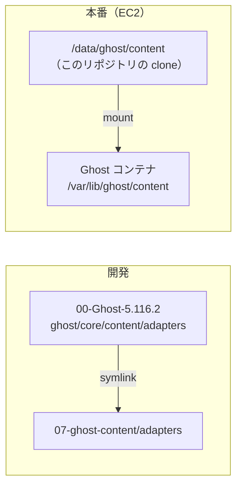

# ghost-content（Ghost の content フォルダ）

backend の Ghost（`00-Ghost-5.116.2`）が使う `content` フォルダ。中心は、画像やファイルを S3 に置く **storage adapter**。
開発では Ghost の `ghost/core/content/adapters` がここの `adapters` を指し、本番ではこのリポジトリの clone が Ghost の content ボリュームになる。

## この文書の内容

| 節 | 内容 |
|---|---|
| [中の構成](#中の構成) | 主なフォルダ |
| [S3 adapter](#s3-adapter) | 何をするか、読む設定と env の名前 |
| [Ghost からの使われ方](#ghost-からの使われ方) | 開発（symlink）と本番（content ボリューム） |
| [adapter を変えるとき](#adapter-を変えるとき) | ビルドとテスト |
| [詳しい文書](#詳しい文書) | 01-ghost-front の docs |

## 中の構成

| 場所 | 中身 |
|---|---|
| `adapters/storage/s3/` | S3 の storage adapter。`src/index.ts` がソース、`dist/index.js` がビルド済みの 1 ファイル（コミット済み）、`index.js` が入口 |
| `themes/` | テーマ（`casper`・`source`）と `locales` |
| `settings/routes.yaml` | Ghost のルート設定 |
| `public/` | Ghost が配る小さな JS・CSS など |

## S3 adapter

[ghost-storage-adapter-s3](https://github.com/colinmeinke/ghost-storage-adapter-s3) をもとに直したもの。

- 画像・メディア・ファイルを S3 に保存し、`<assetHost>/<pathPrefix>/<年>/<月>/<ファイル名>` の URL を返す。
- 元の adapter に足したもの: 一覧（`list`）、ブラウザから直接上げるための署名付き URL（`getPresignedPutUrl`）、
  プレフィックスごとの削除（`deletePrefix`）、日本語などのファイル名をそのまま残す処理。
- Ghost の設定 `storage.s3` から、次の名前を読む:
  `bucket`・`region`・`assetHost`・`pathPrefix`・`accessKeyId`・`secretAccessKey`・`endpoint`・`serverSideEncryption`・
  `forcePathStyle`・`signatureVersion`・`acl`。
  鍵が無いときは AWS SDK の既定の方法（env や instance role）で認証する。
- Ghost には `storage__s3__bucket` のような `__` 区切りの env で渡せる（nconf が設定を上書きする）。
- 次の env があると、設定より優先する:
  `AWS_DEFAULT_REGION`・`GHOST_STORAGE_ADAPTER_S3_PATH_BUCKET`・`GHOST_STORAGE_ADAPTER_S3_ASSET_HOST`・
  `GHOST_STORAGE_ADAPTER_S3_PATH_PREFIX`・`GHOST_STORAGE_ADAPTER_S3_ENDPOINT`・`GHOST_STORAGE_ADAPTER_S3_SSE`・
  `GHOST_STORAGE_ADAPTER_S3_FORCE_PATH_STYLE`・`GHOST_STORAGE_ADAPTER_S3_SIGNATURE_VERSION`・`GHOST_STORAGE_ADAPTER_S3_ACL`。
- `assetHost` には CloudFront のドメインだけを入れる。プレフィックスは adapter が足すので含めない。
  開発は開発用のプレフィックスにし、本番のプレフィックスにしない（[03](https://github.com/aidabo/jibunsee-react/blob/main/docs/development/03-backend-ghost.md#2-初回セットアップ)）。

## Ghost からの使われ方



- **開発:** Ghost の `ghost/core/content/adapters` は `../../../../07-ghost-content/adapters` への symlink。
  このリポジトリを `~/work/legacy/07-ghost-content` に clone していないと、S3 adapter が無く Ghost が動かない
  （[01-workspace.md](https://github.com/aidabo/jibunsee-react/blob/main/docs/development/01-workspace.md)）。
- **本番:** Ghost のイメージには adapter が入っていない。ホストの `/data/ghost/content` が content として mount され、
  adapter はそこから読まれる（`02-ghost-compose/docker-compose-prd.yml`）。
  mars-times（janabiz）の backend では、`01-ghost-front/tenants/janabiz/deploy/backend/deploy-on-ec2.sh` が、
  そこが空のときだけこのリポジトリを `ubuntu` ユーザーで clone する。clone 済みなら更新しない。
- 本番は `dist/index.js` を使うので、本番に `node_modules` は要らない。

## adapter を変えるとき

```bash
cd ~/work/legacy/07-ghost-content/adapters/storage/s3
npm install          # devDependencies（tsc・esbuild）を入れる
npm run build        # src/index.ts → dist/index.js
```

- `dist/index.js` もコミットする（本番はこれを読む）。
- テストは Ghost 側にある: `00-Ghost-5.116.2/ghost/core/test/unit/server/adapters/storage/s3.test.js`
  （symlink を通して `src/index.js` を読む）。`cd ghost/core && yarn test:single test/unit/server/adapters/storage/s3.test.js` で流せる。
- 本番に入れるには、ホストの `/data/ghost/content` の clone を新しくして Ghost を再起動する。
  janabiz の deploy は clone 済みなら何もしないので、配布しただけでは入らない。

## 詳しい文書

- [03-backend-ghost.md](https://github.com/aidabo/jibunsee-react/blob/main/docs/development/03-backend-ghost.md) — Ghost の起動と S3 の env
- [01-workspace.md](https://github.com/aidabo/jibunsee-react/blob/main/docs/development/01-workspace.md) — リポジトリの置き場所とリンク
- adapter の元の説明（英語）は `adapters/storage/s3/README.md`、ライセンスは `adapters/storage/s3/LICENSE.md`。
